# Agui：为 Windows GUI 而生的解释型语言

Agui 是一门轻量、解释执行的脚本语言。它用接近 Python 的缩进语法，直接创建**原生 Windows 控件**，不需要 Electron、浏览器或额外运行时。解释器本身由 Go + Win32 API 写成，最终产物是一个可以双击运行的独立 `.exe`。当前版本 **0.5.0**。

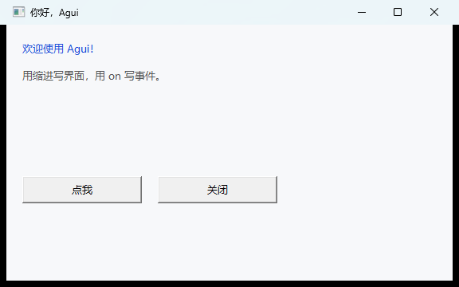

```agui
win = window("你好，Agui", w=560, h=320)

label("欢迎使用 Agui！", fg="#1D4ED8")
name = edit("世界", w=260)
greet = button("打招呼", w=150)

on greet.click:
    msgbox("你好，" + name.text + "！")

on win.close:
    print("再见")
```

保存为 `hello.ag`，运行：

```powershell
.\agui.exe run hello.ag
```

---

## 特性

- **原生 GUI**：窗口、菜单栏、标签、按钮、输入框、复选框、列表、下拉框、进度条、滑块、图片、富文本、表格，全部是 Win32 控件。
- **现代外观**：运行时激活 Common Controls v6 视觉样式，按钮、复选框、滚动条跟随系统主题。
- **多窗口**：`window()` 可创建任意多个顶层窗口（独立窗口，或用 `parent=` 创建从属窗口），每个窗口有独立的控件树、菜单栏和背景色。
- **自绘彩色按钮**：按钮的 `fg` / `bg` 真正生效，支持自定义文字色、背景色和默认按钮样式。
- **类 Python 语法**：缩进代码块、`if/elif/else`、`while/for`、`func`、闭包、切片（含步长）、单行/多行 lambda、`try/catch/finally`、`raise`、`import`、轻量 `class`。
- **事件即语法**：`on btn.click:` 注册点击事件，代码结构一眼可见。
- **后台任务**：`async(work, then=...)` 返回可等待、可取消的 `task`；任务在后台协作式运行，完成后回到 UI 线程更新界面。
- **布局容器**：`panel` / `scroll` / `grid` 可嵌套，支持明确锚点、滚动和网格排列；隐藏控件不占位。
- **省心布局**：不写坐标就自动纵向排列；写了 `x/y/w/h` 就精确控制；`anchor=` 让控件贴在父容器边上；窗口缩放时自动重排。
- **中文关键字别名**：`如果 / 否则 / 对于 / 在 / 函数 / 返回 / 监听 / 尝试 / 捕获 / 导入 / 匿名` 等可直接使用。
- **单文件打包**：`agui build app.ag` 把脚本和资源一起塞进 exe，双击即运行；可嵌入图标和版本信息。
- **内置实用库**：消息框、确认框、输入框、文件对话框、文件读写、剪贴板、定时器、截图、格式化字符串、JSON、base64、HTTP、WebSocket。
- **更多控件**：groupbox 分组容器、treeview、canvas 画布、可编辑/可排序表格、菜单快捷键与图标、文件拖放、radio、状态栏、日期/时间选择器、tooltip。
- **无第三方依赖**：只用 Go 标准库和系统 DLL。

| 计数器 | 表单 |
| --- | --- |
| 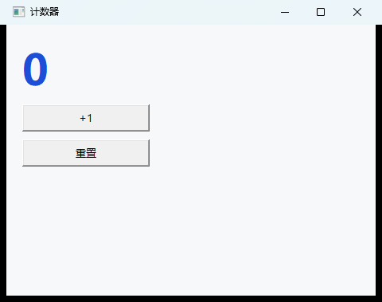 | 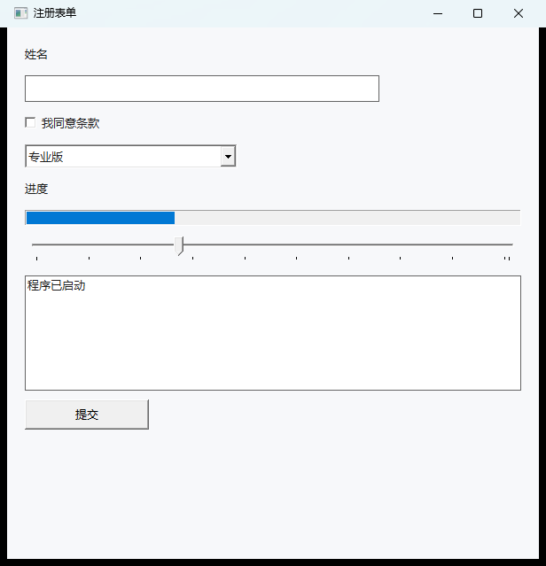 |

---

## 快速开始

### 1. 构建解释器

需要 Windows 10/11 和 Go 1.22+（本项目使用 Go 1.26 验证）。在项目根目录运行：

```powershell
.\build.bat
# 或者（如果 PowerShell 允许运行脚本）
.\build.ps1
```

如果提示“在此系统上禁止运行脚本”，直接用 `build.bat`，它会在内部使用 `-ExecutionPolicy Bypass` 调用构建脚本。

脚本会生成两个文件：

| 文件 | 用途 |
| --- | --- |
| `agui.exe` | 控制台版，适合在终端运行脚本、查看 `print` 输出和错误 |
| `aguiw.exe` | 无控制台版，`agui build` 默认用它作为打包底版 |

也可以手动构建：

```powershell
go build -o agui.exe ./cmd/agui
go build -ldflags "-H=windowsgui" -o aguiw.exe ./cmd/agui
```

### 2. 运行与检查

```powershell
.\agui.exe run examples\hello.ag       # 运行
.\agui.exe check examples\hello.ag     # 只检查语法
.\agui.exe examples\hello.ag           # run 的简写
```

`init` 会生成一个可直接运行的项目模板；`--debug` 会打印事件日志，并在出错时把全局变量输出到 stderr。

### 3. 打包成独立 exe

```powershell
.\agui.exe build examples\hello.ag -o hello.exe
.\hello.exe
```

带图标和版本信息：

```powershell
.\agui.exe build examples\hello.ag -o hello.exe `
  --icon assets\app.ico `
  --product "我的工具" --company "Agui" `
  --description "示例程序" --file-version 1.2.3.4
```

`(Get-Item .\hello.exe).VersionInfo` 可以查看嵌入的版本字段。

把图片、数据文件和 `.ag` 模块一起打包：

```powershell
.\agui.exe build app.ag -o app.exe --asset assets --asset data\config.json
```

- `--asset` 可以重复；目录会以目录名作为虚拟前缀挂载（如 `assets/logo.png`），入口脚本同目录下的所有 `.ag` 会自动包含，便于 `import`。
- 脚本里的 `read_file`、`image`、`window(icon=...)`、`menu.item(icon=...)` 会优先读取内嵌资源，找不到再读磁盘。
- 资源图片需要真实路径给 GDI+ 时，运行时会解压到用户缓存目录；不可写时退回程序目录的 `.agui-cache`。

`agui build` 会把脚本追加到 `aguiw.exe`（无控制台）之后；找不到 `aguiw.exe` 时会退回控制台版并给出提示。加 `-console` 可以强制使用控制台版，方便看 `print` 输出。

打包后的 exe 也接受 `--shot=文件.png`（截图后退出）和 `--debug`（事件/全局变量调试），方便做自动化截图验证。

> 生成的 exe 默认没有代码签名，Windows SmartScreen 可能提示“未知发布者”。可以用 `scripts/sign.ps1` 做本机自签名，详见 [签名说明](docs/signing.md)。自签名只适合本地测试，SmartScreen 声誉仍需要正式证书和时间积累。

---

## 语言速览

### 缩进与注释

```agui
# 井号注释
// 双斜杠也可以

if 1 < 2:
    print("缩进决定代码块")
else:
    print("不会执行")
```

缩进可以用空格或 Tab，同一文件内保持一致即可。括号 `[]`、`()`、`{}` 内的换行会被忽略，长表达式可以分多行写。

### 变量与值

```agui
name = "Agui"
year = 2026
ok = true
nothing = null

items = ["苹果", "香蕉"]
person = {"name": "小明", "age": 12}
```

Agui 是动态类型语言。数字统一是浮点数（打印整数时不带 `.0`），`+` 在任一边是字符串时做拼接，也可以直接拼接列表、合并字典。

### 控制流与函数

```agui
func fib(n):
    if n < 2:
        return n
    return fib(n - 1) + fib(n - 2)

total = 0
for i in range(10):
    if i % 2 == 0:
        continue
    total += i

while total > 20:
    total -= 2

print("fib(10) =", fib(10), "total =", total)
```

函数支持默认参数、关键字参数和闭包：

```agui
func greet(name, greeting = "你好"):
    return greeting + "，" + name

print(greet("世界"))
print(greet("Agui", greeting="Hello"))
```

### 切片、lambda 与异常

```agui
items = [1, 2, 3, 4, 5]
print(items[1:3])      # [2, 3]
print(items[-2:])      # [4, 5]
print("abcdef"[1:4])   # bcd

double = lambda x: x * 2
print(double(21))      # 42

try:
    x = 1 / 0
catch err:
    print("出错了：", err)
```

切片支持 `[lo:hi]`、`[:hi]`、`[lo:]`、`[:]`、`[lo:hi:step]` 和负步长，负下标从末尾计算；对列表和字符串都有效。lambda 既可以是单表达式，也可以是多行块。

`try/catch` 会捕获运行时错误，把错误文本绑定到变量；`finally` 一定会执行，`raise` 可以主动抛错；`break`、`continue`、`return` 不会被误捕获。

### 导入其他文件

```agui
import "lib/math"
print(square(7))
```

`import` 支持相对路径，省略 `.ag` 会自动补全；同一个文件只执行一次。导入文件里的函数和变量进入当前作用域。

### 事件

```agui
win = window("事件示例", w=480, h=300)
hits = 0
display = label("0", h=50)
btn = button("点我", w=140)

on btn.click:
    hits += 1
    display.text = "点击次数：" + str(hits)

on win.close:
    print("窗口关闭")
```

事件处理器可以读写外部变量、修改控件属性、调用函数。处理器出错时会弹出错误对话框，程序继续运行。

### 菜单

```agui
file = menu("文件(&F)")
open = file.item("打开(&O)...", accel="Ctrl+O")
recent = file.submenu("最近打开")
recent.item("a.ag")
file.separator()
file.item("退出(&X)", quit)

view = menu("视图(&V)")
status = view.item("状态栏", checkable=true, checked=true)

on open.click:
    msgbox("打开文件的逻辑")

on status.click:
    print("状态栏：", status.checked)
```

`menu.item(文字, 回调?, accel=, checkable=, checked=, enabled=, icon=)` 返回菜单项；`submenu()` 创建子菜单，`separator()` 创建分隔线。`accel` 会注册为真实快捷键（如 `"Ctrl+O"`、`"F5"`），菜单右侧同时显示快捷键文本；`checkable` 项点击时自动翻转 `checked`；`icon=` 指定 png/jpg 菜单图标。`&` 后面的字母是 Alt 访问键。

### 自动布局与精确定位

```agui
window("布局", w=520, h=360)

label("第一行：自动排列")
edit("自动占满宽度")
button("默认宽 150")

# 精确坐标（单位：逻辑像素）
button("右下角", x=360, y=300, w=140, h=36)
```

- 不写 `x`：左边距 20。
- 不写 `y`：按创建顺序自动向下排列。
- 不写 `w`：标签、输入框、复选框、列表、进度条、滑块会自动占满可用宽度；按钮默认 150，下拉框默认 260。
- 窗口缩放时，自动布局的控件会重新排列。
- `anchor="right bottom"` 让控件贴在父容器右边/底边；同时写 `left right` 或 `top bottom` 会拉伸。
- `visible=false` 的控件不参与布局，不占位置。

容器让复杂界面保持可组合：

```agui
card = panel(x=20, y=20, w=360, h=220)
label("账户", parent=card)
edit("用户名", parent=card)
check = checkbox("记住我", parent=card)

side = scroll(x=400, y=20, w=300, h=220)
for i in range(20):
    label("列表项 " + str(i), parent=side)

keys = grid(cols=3, x=20, y=260, w=420, h=160)
for k in ["7", "8", "9", "4", "5", "6"]:
    button(k, parent=keys)

fabs = button("确定", anchor="right bottom", x=20, y=20, w=120, h=36)
```

`panel` 是无滚动容器，`scroll` 带垂直滚动条和滚轮事件，`grid` 按 `cols` 排列子控件。它们都可以嵌套 groupbox，也可以再嵌套同类容器。

### 多窗口、图片与表格

```agui
win = window("主窗口", w=560, h=420, icon="assets/app.ico")
pic = image("assets/agui.png", w=320, h=200, fit=true)
rows = [["张三", "90"], ["李四", "85"]]
grid = table(["姓名", "分数"], rows, h=160)

func open_child():
    child = window("子窗口", w=360, h=240)
    label("这是独立窗口", x=20, y=20)
    button("关闭", x=20, y=70)

on win.close:
    print("主窗口关闭")
```

每次调用 `window()` 都会创建一个新的顶层窗口；默认是独立窗口，传 `parent=win` 可创建从属窗口。用 `win.use()` / `win.activate()` 可以切换后续控件默认放入哪个窗口，`win.close()` 关闭该窗口。`image()` 支持 png/jpg（GDI+ 解码），`fit=true` 保持比例缩放；`table()` 基于 ListView，支持表头、选中行和单元格读写。

---

## 控件与 API 速查

详细的属性、方法和事件说明见 [语言参考](docs/language.md)。

### 控件

| 调用 | 说明 | 常用参数 |
| --- | --- | --- |
| `window(title, w=900, h=640)` | 创建新的顶层窗口 | `bg`, `resizable`, `icon` |
| `menu(title)` | 菜单栏中的一级菜单 | 用 `menu.item()` / `menu.submenu()` 添加条目；`item` 支持 `accel`、`icon` |
| `label(text)` | 静态文字 | `fg`, `bg`, `font` |
| `button(text="按钮")` | 按钮；`fg`/`bg` 会启用自绘 | `on` 事件、几何参数 |
| `edit(text="", multiline=false)` | 单行/多行输入框 | `readonly`, `password` |
| `richedit(text="", readonly=false)` | 富文本编辑框 | `append()`、`format()` |
| `checkbox(text, checked=false)` | 复选框 | `checked` |
| `listbox(items=[])` | 列表框 | `items`, `h` |
| `combo(items=[])` | 下拉框 | `items`, `selected` |
| `progress(value=0, max=100)` | 进度条 | `value`, `max` |
| `slider(value=0, min=0, max=100)` | 滑块 | `value`, `min`, `max` |
| `image(src, fit=true)` | png/jpg 图片 | `w`, `h`, `fit`, `bg` |
| `table(headers, rows)` | 表格（ListView） | `headers`, `rows`, `selected`, `editable` |
| `groupbox(text)` | 分组容器；子控件用 `parent=group` | `parent`, `h` |
| `panel()` | 无滚动布局容器 | `parent`, `anchor` |
| `scroll()` | 带垂直滚动条的容器 | `parent`, `h`, `scroll_y` |
| `grid(cols=2)` | 网格布局容器 | `cols`, `parent` |
| `tree(items)` | 树形控件 | `items`, `h` |
| `canvas(w=, h=)` | 自绘画布 | `bg`, `h` |
| `font("微软雅黑", 14, bold=true)` | 创建字体 | `family`, `size`, `bold`, `italic` |

所有控件都接受这些公共参数：`x`, `y`, `w`, `h`, `fg`, `bg`, `font`, `enabled`, `visible`, `anchor`, `parent`（容器/窗口）。

### 常用属性

| 属性 | 适用控件 | 说明 |
| --- | --- | --- |
| `text` | 窗口、标签、按钮、复选框、输入框、富文本 | 文字内容（窗口为标题） |
| `dropped` / `dropped_files` | 窗口 | 最近一次拖入的文件路径列表 |
| `checked` | 复选框、可勾选菜单项 | 是否勾选 |
| `items` | 列表、下拉框 | 条目列表 |
| `selected` | 列表、下拉框、表格 | 选中下标，`-1` 表示未选中 |
| `count` | 列表、下拉框 | 条目数量 |
| `value` | 进度条、滑块 | 当前值 |
| `min` / `max` | 滑块、进度条 | 范围 |
| `readonly` / `password` | 输入框、富文本 | 只读 / 密码模式 |
| `src` / `path` | 图片 | 图片路径 |
| `fit` | 图片 | 保持比例缩放 |
| `rows` / `headers` | 表格 | 行数据 / 表头 |
| `editable` / `editing` | 表格 | 是否可双击编辑 / 是否正在编辑 |
| `selected` / `count` | tree | 选中节点文字 / 节点总数 |
| `row_count` / `column_count` | 表格 | 行数 / 列数 |
| `enabled` / `visible` | 所有控件 | 启用 / 显示 |
| `x` / `y` / `w` / `h` | 所有控件 | 位置和大小（逻辑像素） |

### 常用方法

```agui
btn.focus()          # 获得焦点
btn.click()          # 以程序方式点击（会触发 click 事件）
entry.clear()        # 清空输入框
entry.append("追加")  # 追加文本
list.add_item("新条目")
list.remove_item(0)
list.select(2)       # 选中第 3 项
win.center()         # 窗口居中
win.minimize()
win.close()

rich = richedit()
rich.append("标题", bold=true, color="#1D4ED8", size=22)
rich.append("正文", italic=true)

grid.add_row(["王五", "88"])
grid.set_cell(0, 1, "95")
grid.select(1)
print(grid.selected, grid.get_cell(0, 0))
grid.sort(1)         # 按第 2 列排序
grid.edit_cell(0, 1)
grid.set_edit_text("99")
grid.end_edit(true)

t.select("window.go") # tree
t.add_child("docs", "new.md")
t.expand_all()

c.rect(20, 20, 160, 80, color="#2563EB", fill=true)
c.text(24, 40, "canvas", color="#FFFFFF", size=18)

win.simulate_drop(["a.txt"])   # 自动化测试用

pic.load()           # 重新加载图片
pic.set_src("other.png")
```

### 事件

| 控件 | 事件 |
| --- | --- |
| `window` | `close`, `resize`, `drop` |
| `button` | `click` |
| `checkbox` | `click`, `change` |
| `label` | `click`, `dblclick` |
| `edit` | `change` |
| `richedit` | `change`, `click` |
| `image` | `click`, `dblclick` |
| `listbox` | `select`, `dblclick` |
| `combo` | `select`, `change`, `dblclick` |
| `slider` | `change` |
| `table` | `select`, `click`, `dblclick` |
| `tree` | `select`, `expand`, `dblclick` |
| `canvas` | `click` |
| `menuitem` | `click` |
| `progress` | 无 |

```agui
on list.select:
    print("选中了", list.selected)
```

---

## 0.5 新增能力速览

- **GUI 补齐**：`radio` 单选按钮、`statusbar` 底部状态栏、`date` / `time` 原生日期时间选择器、任意控件 `tooltip`。
- **窗口控制**：`center`、`topmost`、`opacity`、`state`，以及 `center()` / `flash()`；多窗口同样适用。
- **HTTP 增强**：`http_put/patch/delete/head`、`http_json`、`http_download`、`http_upload`，以及 headers/cookies/auth/重定向/代理/超时/重试/`raise=false` 和 URL 工具。
- **WebSocket 客户端**：`ws_connect()`，支持 `open/message/close/error` 事件、文本/二进制帧、分片、ping/pong 和 `recv()`。
- **测试**：新增 HTTP 扩展与 WebSocket 事件回归测试；解析器允许 `raise=` 作为关键字参数。

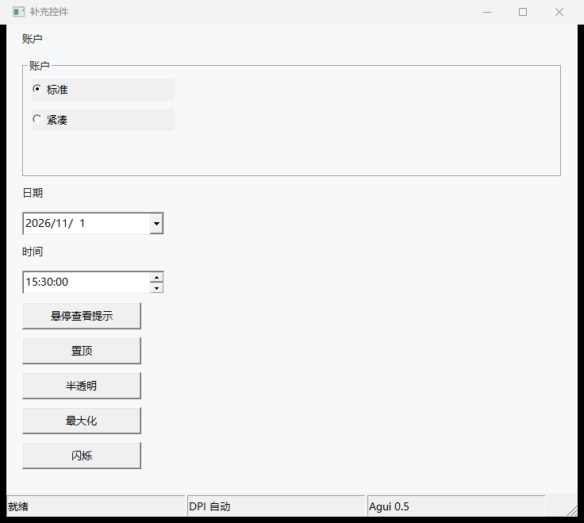

---

## 0.4 新增能力速览

- **异步任务对象**：`async()` 返回 `task`，支持 `status`、`cancel()`、`wait()`、`result`；任务使用协作式调度，后台计算期间界面仍可响应，退出时会取消未完成任务。
- **资源/模块打包**：`agui build --asset 目录或文件` 把图片、数据文件和 `.ag` 模块一起嵌进 exe；`import`、`read_file`、`image`、窗口图标、菜单图标都优先读取内嵌资源。
- **布局引擎**：新增 `panel`、`scroll`、`grid` 容器，支持嵌套、`anchor="right bottom"`、隐藏控件不占位、滚动容器和网格排列。
- **表格增强**：修改 `headers` 不再清空行；编辑时会校验行号并把编辑框裁剪在可见区域；保存单元格后触发 `edit` 事件。

---

## 0.3 新增能力速览

- **语言**：`class` 轻量类、多行 lambda、`try/catch/finally`、`raise`、切片步长 `[lo:hi:step]`。
- **控件**：`groupbox`、`tree`、`canvas`；表格支持双击单元格编辑与按列排序；菜单支持真实快捷键和图标。
- **交互**：窗口 `drop` 事件与 `dropped` 文件列表；`win.simulate_drop([...])` 用于自动化测试。
- **内置库**：`json_encode` / `json_decode`、`base64_encode` / `base64_decode`、`http_get` / `http_post` / `http_request`。

---

## 内置函数

### 输出、转换与类型

`print(...)`、`warn(...)`、`str(v)`、`num(v)`、`int(v)`、`bool(v)`、`type(v)`、`len(v)`、`format(模板, ...)`

`format` 支持 `{}` 顺序占位和 `{name}` 关键字占位：

```agui
print(format("你好，{name}！你 {age} 岁。", name="小明", age=12))
print(format("{} + {} = {}", 1, 2, 3))
```

### 字符串

`upper`, `lower`, `trim`, `split`, `join`, `replace`, `contains`, `startswith`, `endswith`, `substr`, `find`

字符串也可以用方法形式：`"Agui".upper()`、`"a,b".split(",")`。

### 列表与字典

`list`, `dict`, `append`, `pop`, `insert`, `remove`, `sort`, `reverse`, `keys`, `values`, `items`, `has`, `get`, `set`

```agui
items = [3, 1, 2]
items.sort()
items.push(4)
print(items.join("-"))          # 1-2-3-4

person = {"name": "小明"}
print(person.get("age", 0))     # 0
```

### 数学、时间与工具

`range`, `abs`, `round`, `floor`, `ceil`, `sqrt`, `pow`, `min`, `max`, `sum`, `random`, `randint`, `now`, `timestamp`, `sleep`

### 文件

`read_file`, `write_file`, `append_file`, `file_exists`, `delete_file`, `list_dir`, `mkdir`, `basename`, `dirname`, `join_path`, `abs_path`, `cwd`

### JSON、base64、HTTP 与 WebSocket

```agui
data = {"name": "Agui", "items": [1, 2, 3]}
text = json_encode(data)
print(json_decode(text).name)

print(base64_encode("hello"))
print(base64_decode("aGVsbG8="))

r = http_get("https://example.com", timeout=10, retry=2, raise=false)
print(r.status, r.ok, r.content_type, r.length)

r = http_json("https://api.example.com/items", {"name": "Agui"})
print(r.json)

http_download("https://example.com/logo.png", "logo.png")
print(url_parse("https://example.com/a?x=1"))

ws = ws_connect("ws://127.0.0.1:8765", timeout=5)
on ws.message:
    print("收到", ws.message, ws.type)
    ws.close()
ws.send("hello")
```

`json_encode(v, pretty=false)`、`json_decode(s)`、`base64_encode(s, urlsafe=false)`、`base64_decode(s, urlsafe=false)`。

HTTP：`http_get`、`http_post`、`http_put`、`http_patch`、`http_delete`、`http_head`、`http_request`、`http_json(url,data,method="POST")`、`http_download(url,path)`、`http_upload(url,files=)`；通用参数 `headers=, timeout=, cookies=, auth=, follow_redirects=, max_redirects=, proxy=, insecure=, retry=, retry_delay=, raise=`。返回 `{status, ok, body, headers, url, content_type, length, elapsed, cookies, json}`；4xx/5xx 默认抛错，`raise=false` 返回带 `error` 的字典。URL 工具：`url_encode`、`url_decode`、`query_encode`、`url_parse`。

WebSocket：`ws_connect(url, headers=, timeout=15, protocols=, origin=, insecure=false)`；事件 `open/message/close/error`；方法 `send`、`send_binary`、`recv(timeout=5)`、`ping`、`close`；属性 `connected`、`closed`、`message`、`type`、`count`、`last_error`。详见 [docs/language.md](docs/language.md) 16.21/16.22。

### 对话框与剪贴板

```agui
msgbox("保存成功")
if confirm("确定要退出吗？"):
    quit()

name = input("请输入姓名：")
if name != null:
    print("你好，", name)

path = open_file("文本文件|*.txt|所有文件|*.*")
if path != null:
    content = read_file(path)
    write_file("备份.txt", content)

set_clipboard("复制到剪贴板")
print(get_clipboard())
```

### GUI 控制

```agui
run()                 # 启动消息循环（不写也会在脚本结束后自动运行）
quit()                # 退出消息循环
after(1000, tick)     # 1 秒后执行一次
every(500, refresh)   # 每 0.5 秒执行
cancel_timer(id)      # 取消定时器
screenshot("shot.png")

async(work, then=done) # work 在后台协作式执行，done 回到 UI 线程
t = async(work)        # 返回 task 对象
print(t.status)        # running / done / failed / cancelled
t.wait(2)              # 最多等 2 秒
t.cancel()             # 请求取消
set_recursion_limit(200)
print(get_recursion_limit())
```

`after` / `every` 和 `async(..., then=...)` 都接受函数值，可以直接传 lambda：

```agui
after(500, lambda: msgbox("半秒到了"))
t = async(lambda: read_file("big.txt"), then=lambda: msgbox("读取完成"))
print(t.wait(5), t.status)
```

后台任务里不要直接操作控件；把界面更新放在 `then` 回调里。任务与解释器共享执行权，但会在语句之间主动让出，所以后台做 CPU 计算时窗口仍能响应；如果任务卡在无法让出的单条原生调用里，取消要等该调用返回。退出时未完成任务会被取消，最多等待约 2 秒。

### 命令行参数

```agui
print(args)           # 运行脚本时附加的参数列表
print(script_path)    # 脚本路径；打包后为 "内置脚本"
```

---

## 示例

| 文件 | 说明 |
| --- | --- |
| [hello.ag](examples/hello.ag) | 最小窗口、按钮、消息框 |
| [counter.ag](examples/counter.ag) | 事件、变量、字体、关闭事件 |
| [form.ag](examples/form.ag) | 输入框、复选框、下拉框、列表、进度条、滑块 |
| [menu.ag](examples/menu.ag) | 菜单栏、菜单项事件、分隔线 |
| [menu2.ag](examples/menu2.ag) | 子菜单、勾选菜单项、真实快捷键 |
| [colors.ag](examples/colors.ag) | 自绘彩色按钮、窗口背景色 |
| [image.ag](examples/image.ag) | png 图片与窗口图标 |
| [richedit.ag](examples/richedit.ag) | 富文本追加与格式化 |
| [table.ag](examples/table.ag) | 表格、选中行、单元格读写 |
| [table_edit.ag](examples/table_edit.ag) | 表格编辑与排序 |
| [groupbox.ag](examples/groupbox.ag) | 分组容器与组内布局 |
| [tree.ag](examples/tree.ag) | treeview 节点、选中、动态添加 |
| [canvas.ag](examples/canvas.ag) | canvas 线/矩形/圆/文字绘制 |
| [menu_accel.ag](examples/menu_accel.ag) | 真实快捷键 Ctrl+O |
| [menu_icon.ag](examples/menu_icon.ag) | 菜单项图标 |
| [drop_test.ag](examples/drop_test.ag) | 文件拖放事件（模拟） |
| [layout.ag](examples/layout.ag) | panel/scroll/grid 嵌套、锚点与隐藏控件 |
| [lang2.ag](examples/lang2.ag) | class、finally、raise、块 lambda、步长切片 |
| [windows.ag](examples/windows.ag) | 运行时创建独立窗口与从属窗口 |
| [lang_features.ag](examples/lang_features.ag) | 切片、lambda、try/catch、import |
| [async_probe.ag](examples/async_probe.ag) | 后台任务、递归上限 |
| [todo.ag](examples/todo.ag) | 待办清单：列表操作与文件持久化 |
| [calculator.ag](examples/calculator.ag) | 计算器：四则运算、连续运算、除零提示 |
| [event_test.ag](examples/event_test.ag) | 自动触发点击事件，便于验证 |
| [bundle_test.ag](examples/bundle_test.ag) | 打包成 exe 后自截图并退出 |
| [http.ag](examples/http.ag) | HTTP GET、状态/耗时/响应体读取 |
| [websocket.ag](examples/websocket.ag) | WebSocket 连接、消息事件与关闭 |
| [gui_extras.ag](examples/gui_extras.ag) | radio、状态栏、日期/时间、tooltip、窗口控制 |

`todo.ag` 的界面：

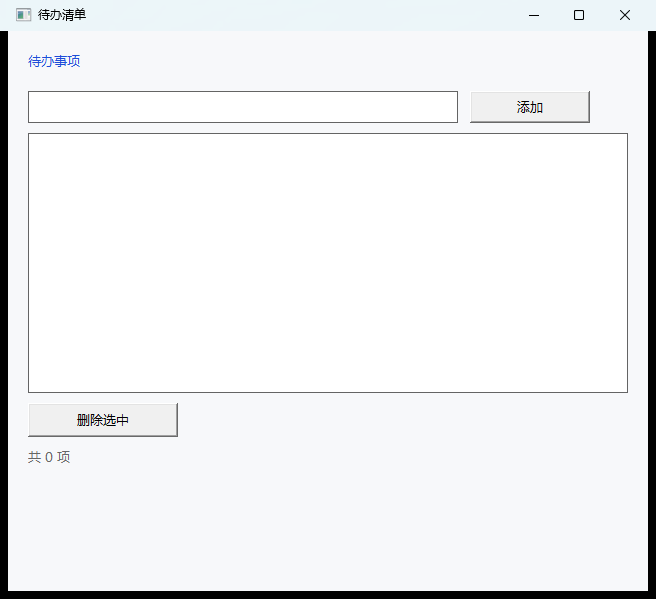

`calculator.ag` 的界面：

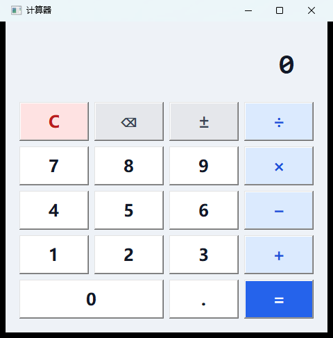

带菜单栏的 `menu.ag`：

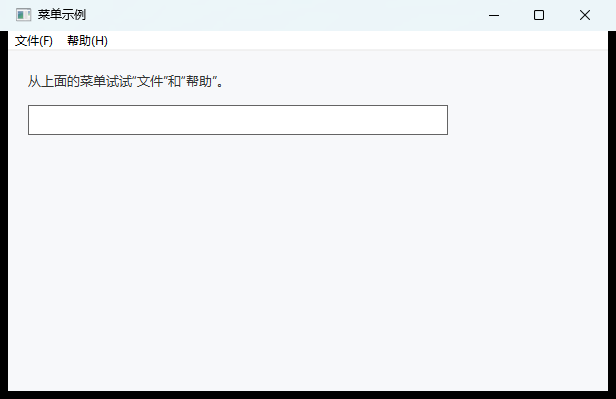

更多新控件：

| 彩色按钮 | 图片与图标 |
| --- | --- |
| 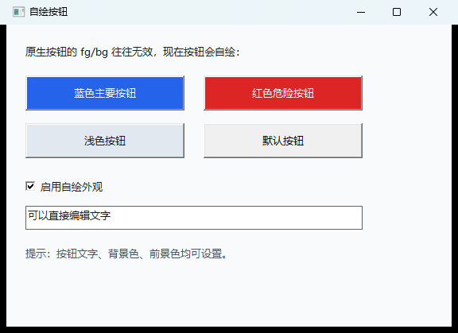 | 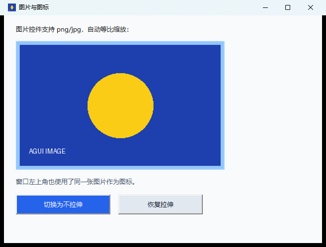 |

| 富文本 | 表格编辑 |
| --- | --- |
| 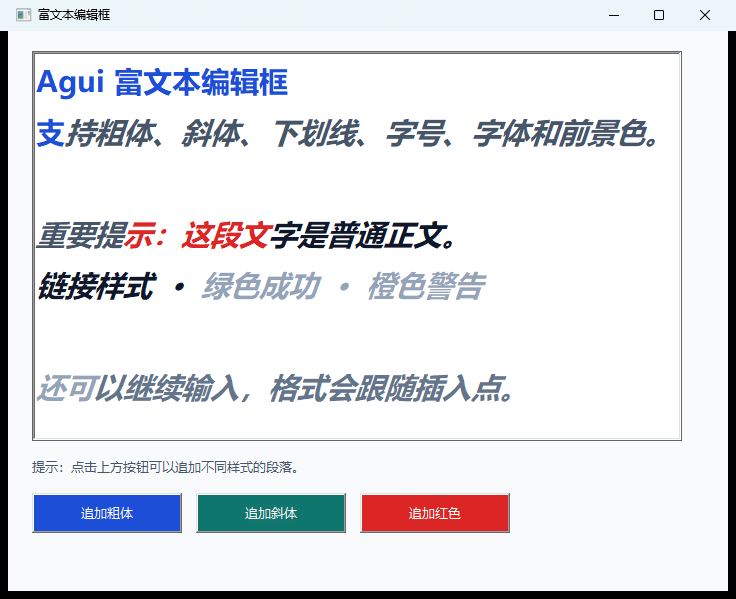 | 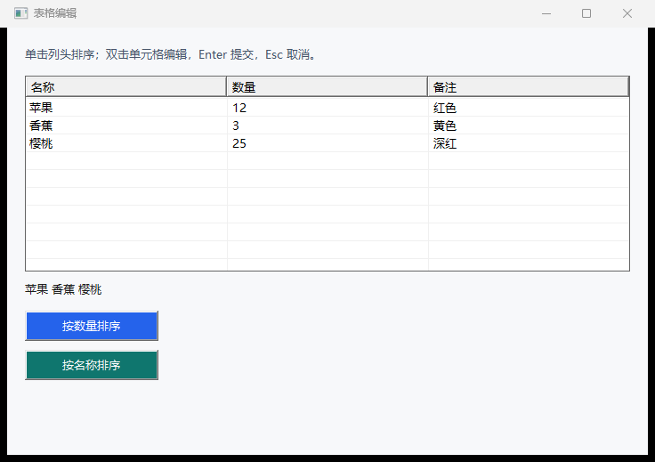 |

| TreeView | Canvas |
| --- | --- |
| 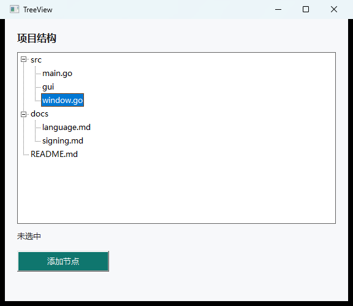 | 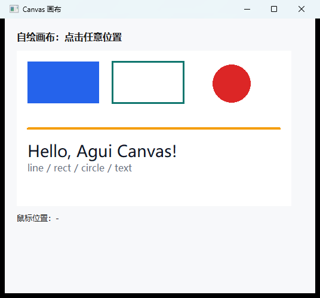 |

| GroupBox | 菜单图标 |
| --- | --- |
| 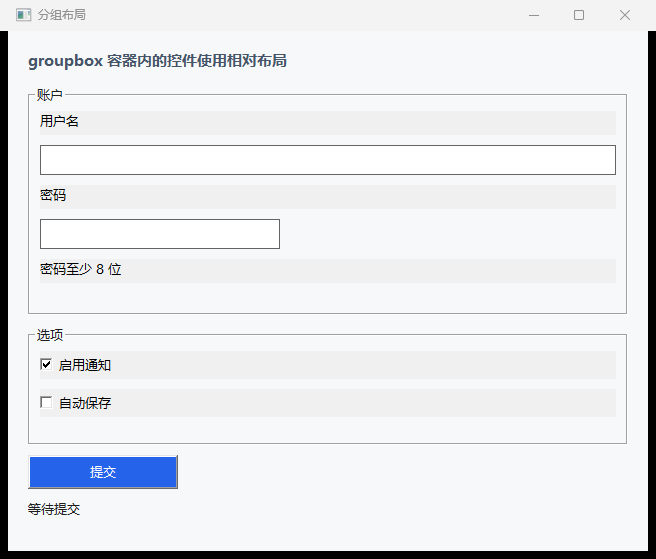 | 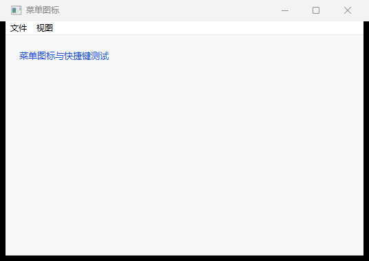 |

自动布局容器（panel / grid / scroll / anchor）：

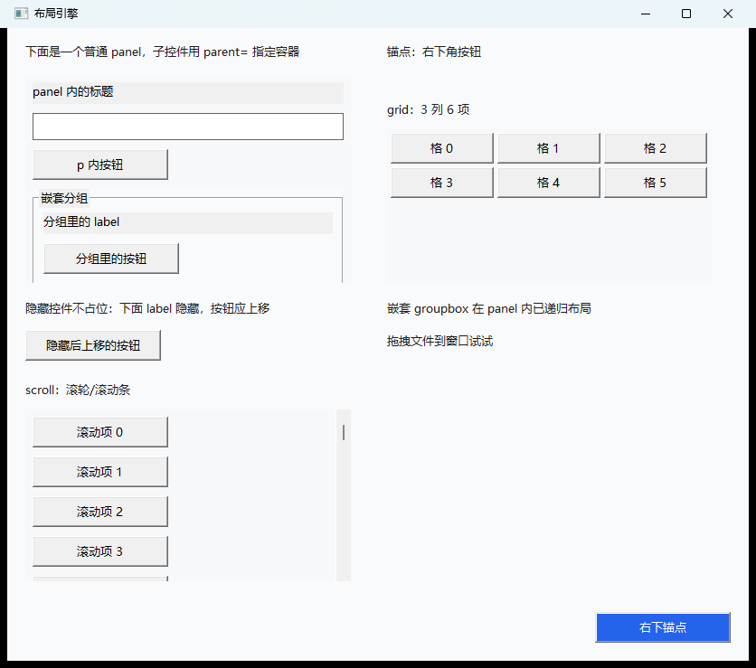

---

## 项目结构

```text
agui/
├─ cmd/agui/            命令行入口、run/check/build/init、脚本打包
├─ internal/
│  ├─ token/            词法单元
│  ├─ lexer/            缩进敏感的扫描器
│  ├─ ast/              语法树
│  ├─ parser/           递归下降 + 运算符优先级
│  ├─ lang/             值、环境、解释器、方法、内置函数、任务、资源包
│  ├─ gui/              Win32 绑定、控件、布局容器、图片、富文本、表格、树、画布
│  └─ winres/           PE 图标/版本资源写入
├─ examples/            示例脚本
├─ assets/              示例图片和图标
├─ scripts/sign.ps1     本机自签名脚本
├─ scripts/ws_echo.py   WebSocket 回显示例服务
├─ docs/language.md     语言与 GUI API 参考
├─ docs/signing.md      代码签名说明
├─ build.bat            免 ExecutionPolicy 的构建入口
└─ build.ps1            一键构建 agui.exe + aguiw.exe
```

---

## 已知限制

- `class` 是轻量对象模型：没有继承、私有成员、类变量、静态方法、运算符重载。
- 多行 lambda 不能直接写在函数调用的圆括号里（括号内不产生换行/缩进）；先赋值再传。
- `import` 是文本级包含；运行时错误仍以主文件行号显示，错误消息里会包含导入文件路径，没有独立源码映射。
- 菜单支持两级子菜单、真实快捷键与图标；没有动态插入/删除整段菜单的重建 API。
- 富文本复杂排版（表格、图片、超链接）仍需要直接使用 Win32 消息。
- 表格支持编辑、排序和 `edit` 事件；没有虚拟化、多选、列宽拖拽保存、分组。
- treeview 与 canvas 是基础封装：tree 没有拖拽节点/多选；canvas 没有贝塞尔曲线、图片、路径填充。
- 布局容器支持纵向、网格、锚点和滚动；没有百分比尺寸、flex 权重和水平流式换行。
- 自绘按钮支持纯色背景和文字色；渐变、圆角、图标需要后续扩展。
- 异步任务是协作式的：CPU 密集脚本会在语句间让出，但单条不可中断的原生调用返回前无法响应取消。
- `screenshot()` 截取的是指定窗口（默认活动窗口）；多窗口时请传窗口对象。
- 生成的 exe 未签名时可能触发 SmartScreen；自签名只能缓解本地信任，不能建立 SmartScreen 声誉。

## 开发与测试

```powershell
go test ./...
```

语言层（词法、语法、解释执行、事件）都有单元测试；GUI 层通过示例脚本和截图做人工/自动冒烟验证。

## License

MIT
